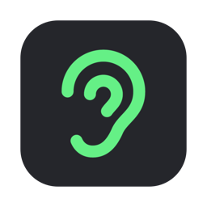
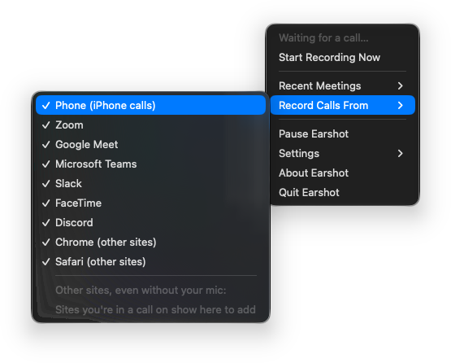
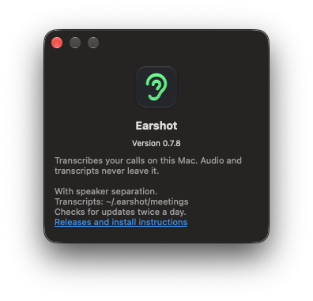
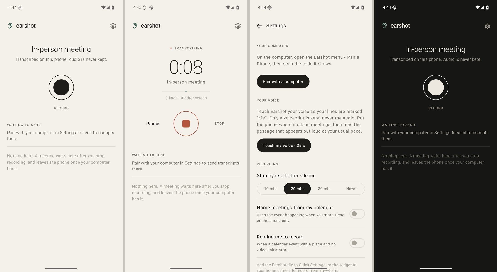
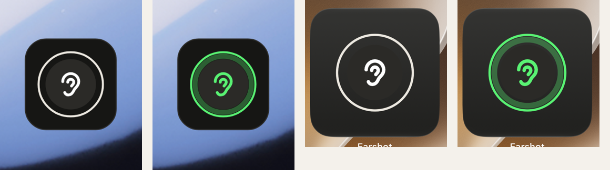
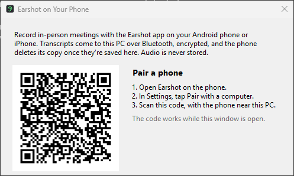

<p align="center">
  
</p>

<h1 align="center">Earshot</h1>

<p align="center">
  <b>Every call, transcribed on your own computer, and ready for your AI agent.</b><br>
  Earshot sits in your menu bar (or system tray), notices when a call starts in any app, and writes a clean transcript: you on one side, everyone else on the other. Nothing leaves your machine.<br>
  New in 0.7: a phone app for <b>in-person meetings</b>, transcribed on the phone and sent to your computer over Bluetooth. Since 0.7.1 that works on Windows too.
</p>

<p align="center">
  <a href="https://github.com/stefan814/earshot-releases/releases/latest"></a>
  
  
  
  
  
</p>

---

- [Why Earshot](#why-earshot)
- [Install](#install)
- [Features](#features)
- [Phone app for in-person meetings](#phone-app-for-in-person-meetings)
- [How it works](#how-it-works)
- [For AI agents (MCP)](#for-ai-agents-mcp)
- [Privacy and your data](#privacy-and-your-data)
- [Settings](#settings)
- [Updates](#updates)
- [Troubleshooting](#troubleshooting)
- [Credits](#credits)

## Why Earshot

- **It just starts.** No calendar to connect and no bot joining the call. When Zoom, Teams, Meet or any other call app starts using your microphone, Earshot starts transcribing. When the call ends, it stops.
- **It knows when you're muted.** Earshot reads the mute button in the call app. Whatever you say while muted stays out of the transcript.
- **"Me" and "Them", always.** Your microphone and the call's audio are recorded separately, so every line is attributed correctly. The full edition also tells the other people apart.
- **Built for agents.** A local MCP server lets Claude, Codex, Cursor or any other MCP client read, search and control your calls. Ask "what did we agree on in my 2pm?" and your agent has the transcript.
- **Private by design.** Speech recognition runs on your computer. Audio is never sent anywhere and isn't kept.

## Install

**Mac** (Apple silicon, macOS 26 or later). Open Terminal and paste:

```bash
curl -fsSL https://github.com/stefan814/earshot-releases/releases/latest/download/install.sh | bash
```

**Windows** (10 or 11, x64 or ARM). Open PowerShell and paste:

```powershell
irm https://github.com/stefan814/earshot-releases/releases/latest/download/Install-Earshot.ps1 | iex
```

On Windows the installer adds Microsoft's .NET 10 runtimes if they're missing (Windows asks for permission first), then downloads the speech models (about 54 MB).

Both commands install **Earshot Lite**. For the full edition, which also tells the other people on a call apart:

| | Mac | Windows |
|---|---|---|
| **Lite** (default) | 1 MB · Me / Them | about 8 MB · Me / Them |
| **Full** | 100 MB · Me / Speaker 1, 2, 3… | about 8 MB + a 23 MB model · Me / Speaker 1, 2, 3… |
| Install Full | add `-s -- --full` after `bash` | `& ([scriptblock]::Create((irm <the address above>))) -Full` |

> **Why a command instead of a download?** Earshot isn't signed with a paid Apple or Microsoft certificate. Files a browser downloads get a "downloaded from the internet" mark, and macOS and Windows warn about those. Files the install command fetches don't get that mark, so there's no warning to click through.
>
> Prefer a regular download? Get the `.dmg` (Mac) or `Earshot-Setup-….exe` (Windows) from the [latest release](https://github.com/stefan814/earshot-releases/releases/latest). On a Mac, the first time you open it, go to **System Settings → Privacy & Security → Open Anyway**. On Windows, click **More info → Run anyway**.

**Android phone** (Android 13 or later), for in-person meetings: on the phone, download `Earshot-…-android.apk` from the [latest release](https://github.com/stefan814/earshot-releases/releases/latest) and open it. Android asks once to allow installs from your browser. See [Phone app](#phone-app-for-in-person-meetings).

The first time it runs, Earshot asks for:
- **Microphone**, for your side of the call.
- **System audio** (Mac), for everyone else.
- **Accessibility** (Mac, optional), for meeting titles, mute buttons and participant names.

## Features

| | Feature | |
|---|---|---|
| 🎙️ | **Automatic start and stop** | Zoom, Teams, Google Meet, Slack huddles, FaceTime, Webex, Discord, WhatsApp, Telegram, Skype, RingCentral, and calls in Chrome, Edge, Arc, Brave, Firefox, Safari and other browsers. |
| 🔇 | **Mute awareness** | Reads the call app's mute button. On web calls, the Chrome extension also checks whether the page is actually sending your audio. Muted speech is left out. |
| 👥 | **Speaker separation** (Full) | NVIDIA's Sortformer model on Mac and a speaker-embedding model on Windows turn "Them" into Speaker 1, 2, 3…, entirely on your computer. Rename speakers from your agent. |
| 🏷️ | **Names and titles** (Mac) | With Accessibility on, Earshot takes the meeting topic, the participant list and who's talking from Zoom and Google Meet captions. The transcript text is still Earshot's own. |
| 💬 | **Chat and shared links** | Zoom and Google Meet chat messages, and links shared in the call, are saved with the meeting. |
| 🎚️ | **Choose which calls** | **Transcribe Calls From** in the menu (the tray menu on Windows) has a switch for each app and web service, so you can leave out, say, FaceTime or Discord. |
| 📱 | **In-person meetings** | The phone app transcribes meetings in the room and sends them to Earshot on your Mac or Windows PC, where they join your other meetings and your agent can read them. |
| 🤖 | **MCP server** | 16+ tools for listing, reading, searching and controlling meetings. Works with any MCP client. |
| ♻️ | **Picks up where it left off** | If Earshot quits, crashes or the computer sleeps mid-call, the same meeting carries on instead of splitting into fragments. |
| 🩺 | **Health checks** | Earshot watches for anything that would quietly stop it recording (a permission switched off, a full disk, a missing model) and shows a fix in its menu. |
| ⬆️ | **One-click updates** | It offers new versions itself and installs them when you click. Never during a call. |

<p align="center">
  
  &nbsp;&nbsp;&nbsp;
  
</p>

## Phone app for in-person meetings

Earshot on your computer hears calls. For meetings in a room, put your phone on the table and tap Record.

<p align="center">
  
</p>

- **Transcribed on the phone.** Speech recognition runs on the phone itself (NVIDIA Parakeet on Android, Apple's on-device recognizer on iPhone). The app has no internet access, and audio is never stored.
- **Sent to your computer over Bluetooth.** On a Mac, open the Earshot menu ▸ **Pair a Phone (In-Person Meetings)…**; on Windows, the same item is in Earshot's tray menu. Scan the code it shows with the phone (in the app's Settings, tap **Pair with a computer**). After that, finished meetings go to the computer by themselves when the two are near each other, or when you tap Send. The phone deletes its copy once the computer confirms it has it. The transfer is encrypted with a key made at pairing. A phone pairs with one computer at a time.
- **Knows your voice.** In Settings, **Teach my voice** has you read a short passage aloud. Your lines are then marked "Me", and other people become Speaker 1, 2, 3…. Only a voiceprint is kept.
- **Record from anywhere.** A one-tap record button for the home screen (Android and iPhone), a Quick Settings tile (Android), and Lock Screen and Control Center buttons (iPhone). The button turns green while recording and yellow while the transcript is saved.
- **Handy extras.** Meetings can be named from your calendar (read on the phone only), recording keeps going with the screen off, and it stops by itself after a stretch of silence.

<p align="center">
  
</p>

<p align="center">
  
</p>

**On Windows**, the PC's Bluetooth adapter has to accept connections from a phone. Most built-in adapters do; some USB dongles don't, and the pairing window says so if yours can't.

**Android:** download the `.apk` from the latest release (see [Install](#install)). It's about 175 MB, almost all of it the speech models. A newer version installs over the old one and keeps your meetings and pairing.

**iPhone (iOS 26):** there's no App Store version yet. It can be built from Earshot's source with Xcode and installed on your own iPhone with a free Apple account. The source isn't public yet, so for now this is for people who have access to it.

The phone apps only transcribe meetings in the room. Phones don't let other apps capture a Zoom, Meet or phone call's audio, so calls are transcribed by Earshot on your computer instead.

## How it works

```
  call app opens the mic ──► Earshot notices (within a second)
                                   │
            ┌──────────────────────┴──────────────────────┐
     your microphone                                 the call's audio
            │                                              │
   mute check (call app's button,                  speaker separation
   or the page via the extension)                  (Full edition)
            │                                              │
            └───────────► on-device speech to text ◄───────┘
                     (Apple SpeechAnalyzer on Mac,
                      Moonshine on Windows)
                                   │
              ~/.earshot/meetings/<date_time_app>/
               transcript.md · transcript.jsonl · meeting_info.json
                                   │
                    MCP server on 127.0.0.1:8796 ──► your AI agent
```

A call ends when the call app stops using the microphone and speakers for 25 seconds, or when its meeting window closes. You can also start and stop by hand from the menu or through MCP.

## For AI agents (MCP)

Earshot runs an MCP server at `http://127.0.0.1:8796/mcp` (Streamable HTTP), on this computer only. The menu's **Copy MCP Server URL** copies the address.

**Claude Code:**

```bash
claude mcp add --transport http --scope user earshot http://127.0.0.1:8796/mcp
```

For any other client, add an HTTP MCP server with that address.

| Tool | What it does |
|---|---|
| `earshot_get_status` | Whether a call is being recorded, which app holds the mic, health problems |
| `earshot_list_meetings` | Recent meetings with titles, apps, times and lengths |
| `earshot_get_transcript` | A meeting's transcript (the current one if none is given) |
| `earshot_search_transcripts` | Search every transcript |
| `earshot_get_meeting_status` | Details of the meeting in progress |
| `earshot_get_chat` · `earshot_get_shared` | Chat messages and links shared in a call |
| `earshot_rename_speaker` | Put a name on "Speaker 2", or list a meeting's speakers |
| `earshot_start_capture` · `earshot_stop_capture` | Start or stop a recording by hand |
| `earshot_pause_capture` · `earshot_resume_capture` | Pause for an off-the-record moment |
| `earshot_start_monitoring` · `earshot_stop_monitoring` | Turn automatic recording on or off |
| `earshot_archive_meeting` · `earshot_delete_meeting` | Tidy up |

Earshot doesn't summarize. That's your agent's job, with whichever model you choose, so Earshot itself never needs an AI service.

## Privacy and your data

- Speech recognition, speaker separation and mute detection all run on your computer.
- Audio is transcribed as it arrives and then discarded. To keep recordings too, set `"saveAudio": true`. They're silent wherever you were muted.
- The MCP server only listens on `127.0.0.1`, so other computers can't reach it. The Chrome extension can only talk to Earshot, and Earshot rejects requests from web pages.
- The phone app has no internet permission at all. It talks only to your paired computer, over Bluetooth, and its waiting meetings are encrypted on the phone.
- The only network requests are the speech-model download (Windows install) and a small check for new versions twice a day, which you can turn off.

Everything is in a folder you own:

```
~/.earshot/
├── config.json                    settings
├── earshot.log
└── meetings/
    └── 2026-11-03_141502_zoom/
        ├── transcript.md          readable transcript
        ├── transcript.jsonl       one line per utterance, with times and speakers
        ├── meeting_info.json      app, title, start/end, participants
        ├── speakers.jsonl         who spoke when
        └── chat.jsonl             chat messages, if any
```

A transcript looks like this:

```
[14:15:02] Me: Can you walk me through how you got to that estimate?
[14:15:07] Speaker 1: Sure, we took the average of the last three months.
[14:15:15] Speaker 2: And adjusted for the holiday dip.
```

## Settings

Edit `~/.earshot/config.json` (Windows: `%USERPROFILE%\.earshot\config.json`) and restart Earshot.

| Setting | Default | |
|---|---|---|
| `checkForUpdates` | `true` | Look for new versions twice a day |
| `saveAudio` | `false` | Also keep the audio of each call |
| `detectAnyApp` | `false` | Treat any app that uses the mic as a call, not just known call apps |
| `apps` | built-in list | Which apps count as call apps |
| `minMicSeconds` | `3` | How long an app must hold the mic before a meeting starts |
| `endAfterSilentSeconds` | `25` | How long a call app must be silent before the call counts as over |
| `port` | `8796` | The MCP server's port |

## Updates

When a new version is out, Earshot shows one notification and an **Update to Earshot X…** item in its menu. Click either one and Earshot updates and restarts in a few seconds, keeping your edition, permissions and meetings. If you're on a call, it waits until the call ends. Running the install command again also updates.

## Troubleshooting

**Nothing is recorded during calls.** Open the Earshot menu: problems are listed at the top with a **Fix…** button. Most often it's a permission that was switched off.

**Everyone else shows up as silence (Mac).** Allow Earshot under System Settings → Privacy & Security → Screen & System Audio Recording.

**No meeting titles or participant names (Mac).** Allow Earshot under Privacy & Security → Accessibility.

**My words were transcribed while I was muted.** Earshot reads the call app's own mute button; a hardware mute switch or muting in system settings isn't visible to it. For web calls, install the Chrome extension from the menu (**Set Up Chrome Extension…**).

**After updating to 0.6.1, macOS asked for permissions again.** Expected once. Earshot's internal name changed from its old one, so macOS treats it as a new app. You can remove the old entries with `tccutil reset All io.github.stefan814.supercall`.

**Windows blocks it completely.** On PCs with Smart App Control turned on, Windows blocks apps without a paid signature, and there's no "run anyway". It's off on most PCs.

## Credits

Earshot is free to use. It's built on:
- Apple's SpeechAnalyzer.
- [Moonshine](https://github.com/moonshine-ai/moonshine) speech recognition and [sherpa-onnx](https://github.com/k2-fsa/sherpa-onnx).
- The [Silero VAD](https://github.com/snakers4/silero-vad) voice detector.
- NVIDIA's Streaming Sortformer model via [FluidAudio](https://github.com/FluidInference/FluidAudio), under the NVIDIA Open Model License.
- NVIDIA NeMo SpeakerNet.
- Phone app: NVIDIA [Parakeet TDT 110M](https://huggingface.co/nvidia/parakeet-tdt_ctc-110m) speech recognition and NVIDIA NeMo TitaNet-small voiceprints (both CC-BY-4.0) on Android; Apple's SpeechTranscriber and the CAM++ voiceprint model ([3D-Speaker](https://github.com/modelscope/3D-Speaker), via FluidAudio) on iPhone.
